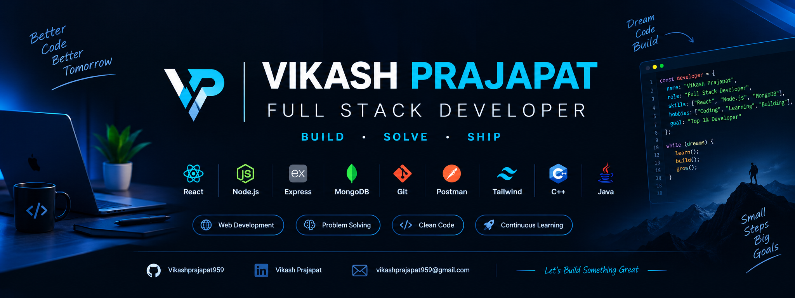

  

  <h1>VIKASH PRAJAPAT</h1>
  <h3>FULL-STACK DEVELOPER · WEB APPLICATIONS · REST APIs</h3>
  
<em>I build practical products with clean interfaces, reliable APIs, and a focus on continuous improvement.</em>

  

    
    
    
  

  

    
  

---

## ⚡ Developer Command Center

<table>
  <tr>
    <td width="50%" valign="top">
      <h3>🎯 My Direction</h3>
      
<strong>Full-Stack Development</strong>

      
Responsive UI · API development · Database integration · Deployment

    </td>
    <td width="50%" valign="top">
      <h3>🛠️ How I Build</h3>
      
Understand → Design → Implement → Test → Document → Improve

    </td>
  </tr>
  <tr>
    <td width="50%" valign="top">
      <h3>💻 Frontend</h3>
      
React · JavaScript · TypeScript · Tailwind CSS · HTML

    </td>
    <td width="50%" valign="top">
      <h3>🔌 Backend & Data</h3>
      
Node.js · Express · Django · FastAPI · REST APIs · MongoDB · MySQL · Firebase

    </td>
  </tr>
</table>

## 🚀 Featured Projects

<table>
  <tr>
    <td width="50%" valign="top">
      <h3>🌐 Razorpay Landing Page UI</h3>
      
<strong>Responsive fintech-style frontend recreation</strong>

      
Built with HTML, Tailwind CSS, and Vite. Includes a multi-section landing page and a public deployment for quick review.

      

        
        
      

      
HTML · Tailwind CSS · Vite · Netlify

      
<em>Independent educational recreation; not the official Razorpay website and does not process payments.</em>

    </td>
    <td width="50%" valign="top">
      
      <h3>🏙️ URBANSENSE</h3>
      
<strong>AI-powered urban intelligence concept</strong>

      
Explores mobile road sensing, computer vision, incident reporting, geospatial mapping, and a command dashboard.

      
Python · YOLOv8 · FastAPI · React · Leaflet · Recharts

      
<em>Preview image is a design mockup, not a live application screenshot.</em>

      <a href="https://github.com/Vikashprajapat959/mobile-urban-intelligence">Explore repository →</a>
    </td>
  </tr>
  <tr>
    <td width="50%" valign="top">
      <h3>✅ TaskBuddy</h3>
      
<strong>Task management mobile app</strong>

      
A Flutter application focused on task organization, progress states, and Firebase integration.

      
Flutter · Dart · Firebase

      <a href="https://github.com/Vikashprajapat959/Task_buddy_app">Explore repository →</a>
    </td>
    <td width="50%" valign="top">
      <h3>🧭 What I’m Improving</h3>
      
Stronger full-stack fundamentals, responsive design, API architecture, debugging, deployment, and problem-solving.

      
<strong>My goal:</strong> build useful software and explain the trade-offs behind it.

    </td>
  </tr>
</table>

## 🧰 Technology Stack

  
  
  
  
  
  
  
  
  
  
  
  
  
  
  
  

| Area | Focus |
|---|---|
| **Frontend** | Responsive layouts, component-driven UI, utility-first styling |
| **Backend** | REST endpoints, application logic, integrations |
| **Data** | Database-backed applications and Firebase services |
| **Engineering workflow** | Git, debugging, documentation, build and deployment checks |

## 📈 GitHub Activity

 

## 🤝 Let’s Connect

**Build thoughtfully. Learn continuously. Ship improvements.**

