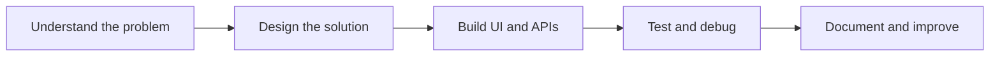

  

  <h1>Vikash Prajapat</h1>
  <h3>Full Stack Developer · Web Applications · APIs · Problem Solving</h3>

  
Building practical software with clean interfaces, useful features, and reliable backend logic.

  
  

---

## About

I'm a **Full Stack Developer** focused on building end-to-end applications—from responsive user interfaces to APIs, data handling, and integration.

- **Frontend:** React, JavaScript/TypeScript, Tailwind CSS
- **Backend:** Node.js/Express, Django, FastAPI
- **Data & services:** MongoDB, MySQL, Firebase
- **Problem solving:** C++, Python, data structures and algorithms

I learn by building, testing, debugging, and improving real projects. I value readable code, useful documentation, and demos that make a project easy to understand.

## Featured Project

### 🏙️ URBANSENSE — AI-Powered Mobile Urban Intelligence

A smart-city project exploring how public transport buses can act as mobile sensing units. The concept combines edge computer vision, compact event reporting, and a central dashboard for urban road and traffic insights.

  

Dashboard design preview · UI mockup, not a screenshot of the live application

**What the project brings together**
- Computer-vision based road-event detection workflow
- FastAPI backend and WebSocket event updates
- React dashboard with GIS mapping and analytics
- Fleet, incident, road-condition, and evidence modules

**Stack:** Python · YOLOv8 · FastAPI · React · Vite · Leaflet · Recharts

[**View URBANSENSE repository →**](https://github.com/Vikashprajapat959/mobile-urban-intelligence)

### ✅ TaskBuddy — Task Management App

A mobile-first task management project for organizing work and tracking task status, with Firebase integration.

**Stack:** Flutter · Dart · Firebase

[**View TaskBuddy repository →**](https://github.com/Vikashprajapat959/Task_buddy_app)

---

## Technical Toolkit

| Area | Technologies |
|---|---|
| **Languages** | C, C++, JavaScript, TypeScript, Python, SQL |
| **Frontend** | React, Tailwind CSS |
| **Backend & APIs** | Node.js, Express, Django, FastAPI, REST APIs |
| **Data & cloud services** | MongoDB, MySQL, Firebase |
| **Tools** | Git, GitHub, VS Code, Vite |
| **Additional experience** | Flutter, Dart, R |

## How I Build

## GitHub Activity

---

**Build thoughtfully. Learn continuously. Ship improvements.**

[GitHub](https://github.com/Vikashprajapat959) · [LinkedIn](https://www.linkedin.com/in/vikash-prajapat-4148a7367/)

