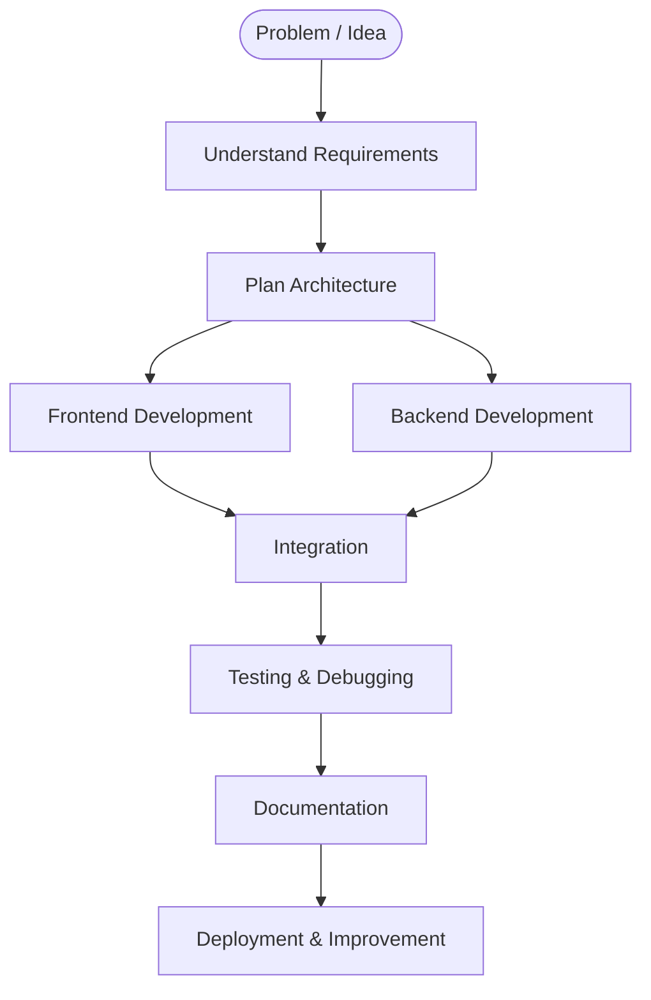

 
<div align="center">


<a href="https://git.io/typing-svg">

</a>

<br/><br/>


<br/><br/>

<a href="https://github.com/Vikashprajapat959">

</a>
<a href="https://www.linkedin.com/in/vikash-prajapat-4148a7367/">

</a>

<br/><br/>


</div>

---

## 👨‍💻 About Me

Hello! I'm **Vikash Prajapat**, a Computer Science student focused on **Full Stack Development and building practical web applications**.

I enjoy developing responsive user interfaces, designing backend APIs, integrating databases, and turning ideas into working software.

My development approach focuses on understanding the problem first, writing maintainable code, testing functionality, and continuously improving the final product.

**What I focus on:**
- Full Stack Web Development
- Frontend Development and Responsive UI
- Backend Development and REST APIs
- Database Design and Integration
- Problem Solving and Data Structures
- Exploring AI-powered web applications

> My goal is to build useful, reliable, and scalable software while continuously improving my engineering skills.

## 🔗 Find Me Online

| Platform | Profile |
|:--|:--|
| 🧑‍💻 GitHub | [Vikashprajapat959](https://github.com/Vikashprajapat959) |
| 💼 LinkedIn | [Vikash Prajapat](https://www.linkedin.com/in/vikash-prajapat-4148a7367/) |
| 🚀 Featured Project | [Razorpay Landing Page](https://vikash-razorpay-landing.netlify.app/) |

## 📑 Table of Contents

- [Developer Command Center](#-developer-command-center)
- [Featured Projects](#-featured-projects)
- [Technology Stack](#-technology-stack)
- [Engineering Workflow](#-engineering-workflow)
- [Engineering Focus](#-engineering-focus)
- [GitHub Analytics](#-github-analytics)
- [Connect With Me](#-connect-with-me)

---

## ⚡ Developer Command Center

| Area | Current Focus |
|:--|:--|
| **Development Direction** | Full Stack Development |
| **Frontend** | Responsive UI, React, JavaScript, TypeScript |
| **Backend** | Node.js, Express, Django, FastAPI |
| **Database** | MongoDB, MySQL, Firebase |
| **API Development** | REST API design and integration |
| **Build Approach** | Understand → Design → Implement → Test → Document → Improve |
| **Long-Term Interest** | Full Stack + AI-powered applications |

### Development Philosophy

```text
01. Understand the problem
02. Plan the architecture
03. Build the user interface
04. Develop backend functionality
05. Integrate APIs and databases
06. Test and debug
07. Document and improve
```

---

## 🚀 Featured Projects

### 1. Razorpay Landing Page UI

<div align="center">


</div>

A responsive landing page UI recreation inspired by Razorpay, built to practice modern frontend development, layout design, and responsive styling.

**Key Highlights**
- Responsive landing page design
- Structured sections and reusable UI patterns
- Modern styling with Tailwind CSS
- Vite-based development setup
- Live deployment using Netlify

**Technology Used**

`HTML` `Tailwind CSS` `Vite` `Netlify`

<div align="center">

<a href="https://vikash-razorpay-landing.netlify.app/">

</a>
<a href="https://github.com/Vikashprajapat959/Razorpay">

</a>

</div>

---

### 2. URBANSENSE — AI-Powered Urban Intelligence Platform

<div align="center">


</div>

An AI-powered urban intelligence concept designed to explore how mobile sensing units and computer vision can support smarter urban mobility and road monitoring.

**Core Features**
- Mobile-based road condition sensing
- Computer vision for urban infrastructure monitoring
- Incident reporting and monitoring
- Geospatial mapping and visualization
- Centralized command dashboard
- Traffic and road intelligence concepts

**Technology Used**

`Python` `YOLOv8` `FastAPI` `React` `Leaflet` `Recharts`

<div align="center">

<a href="https://github.com/Vikashprajapat959/mobile-urban-intelligence">

</a>

</div>

<sub>Note: Project visuals and demonstrations represent the project's concept and interface; they should not be interpreted as independently verified real-world deployment results.</sub>

---

### 3. TaskBuddy — Task Management Application

<div align="center">


</div>

A task management mobile application project focused on organizing tasks and exploring app development with Firebase integration.

**Technology Used**

`Flutter` `Dart` `Firebase`

<div align="center">

<a href="https://github.com/Vikashprajapat959/Task_buddy_app">

</a>

</div>

---

## 🛠️ Technology Stack

### Programming Languages

<p>


</p>

### Frontend Development

<p>


</p>

### Backend Development

<p>


</p>

### Database and Tools

<p>


</p>

---

## 🧠 Engineering Workflow

I follow a structured approach when building software projects.



### Engineering Focus

| Focus Area | What I Work On |
|:--|:--|
| Problem Solving | Breaking problems into smaller steps |
| Code Quality | Writing readable and maintainable code |
| Responsive Design | Building interfaces for different screen sizes |
| API Architecture | Understanding routes, requests and responses |
| Database Integration | Connecting applications with data storage |
| Debugging | Identifying and fixing implementation issues |
| Documentation | Making projects easier to understand and use |

---

## 📊 GitHub Analytics

<div align="center">


<br/>


<br/>


</div>

---

## 🎯 What I'm Improving

- Strengthening Full Stack Development fundamentals
- Improving responsive frontend design
- Understanding backend and API architecture
- Practicing debugging and clean coding
- Improving problem-solving skills
- Building useful and practical software projects

---

## 🤝 Connect With Me

I'm interested in connecting with developers, learning from the community, and collaborating on meaningful software projects.

<div align="center">

<a href="https://github.com/Vikashprajapat959">

</a>

<a href="https://www.linkedin.com/in/vikash-prajapat-4148a7367/">

</a>

<br/><br/>

### "Build. Learn. Improve. Repeat."


</div>
